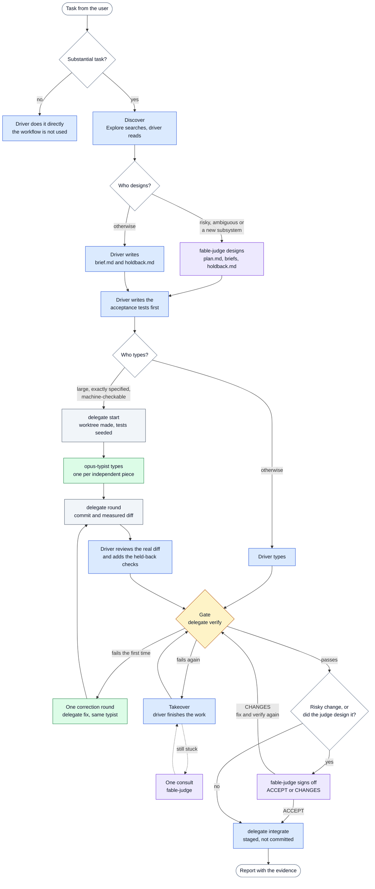
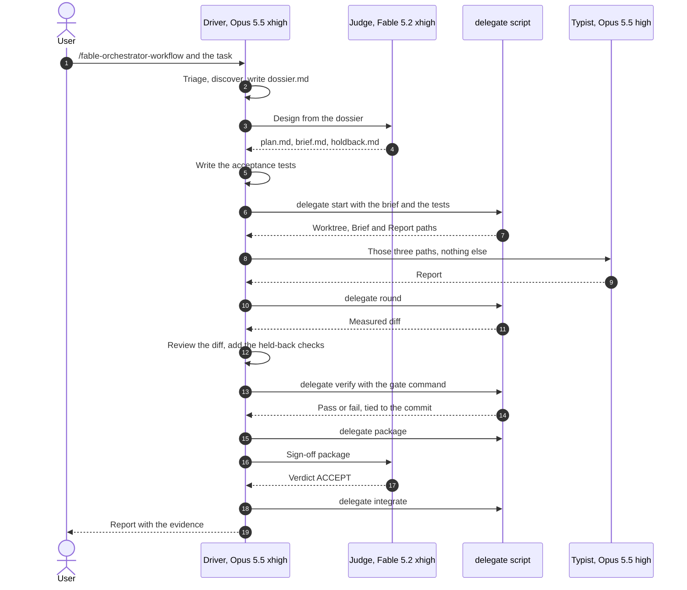

# Claude orchestrator workflow

A Claude Code skill that builds a substantial coding task with three Claude
seats. No code leaves Claude.

| Seat | Who | Model | Does |
|---|---|---|---|
| Driver | the main Claude Code session | Opus 5.5, xhigh effort | explores, writes the acceptance tests, dispatches, reviews, verifies, takes over when needed, reports |
| Judge | `fable-judge` subagent | Fable 5.2, xhigh effort | designs risky or unclear changes, signs off the finished change, answers one consult |
| Typist | `opus-typist` subagent | Opus 5.5, high effort | implements a written brief in its own git worktree |

Two helpers keep the driver's context small: the built-in Explore subagent does
the searching, and a `test-runner` subagent (Haiku 5.5) runs the gate and returns
a short result.

The same pipeline with a DeepSeek typist, for a larger cost saving, is in
[claude-deepseek-orchestrator-workflow](https://github.com/joshuachuaaa/claude-deepseek-orchestrator-workflow).

## The idea

**The gate sets the quality, not the typist.** Nothing the typist writes is
accepted on its word. A change gets in only after it passes checks at least as
strong as the driver would apply to its own work:

1. **Acceptance tests written first.** The driver writes them before any code
   exists and commits them into the typist's worktree. If they change afterwards,
   the gate refuses.
2. **Held-back checks.** Two to five checks the typist never sees, added after
   it has finished.
3. **A measured diff.** The driver reviews the real diff and the real test exit
   code, produced by the `delegate` script, not the typist's report.
4. **One correction, then takeover.** The typist gets one correction round per
   stage. If the gate still fails, the driver finishes the work itself, so the
   result is never worse than the driver working alone.
5. **Sign-off where it matters.** The judge reviews the verified change when it
   designed it or when the change touches a risky domain (auth, money, data
   migrations, concurrency, security, public APIs).

The typist is the same model as the driver at a lower effort. It earns its seat
in two ways: it builds in a fresh, small context while the driver's stays short,
and several typists can build independent pieces at the same time. Only the
judge can raise quality above the driver's, so it is kept for design and risk.

## The pipeline



Blue is the driver (Opus, xhigh), purple is the judge (Fable), green is the
typist (Opus, high), grey is the `delegate` script, and amber is the machine
gate.

## One task, seat by seat

The seats never share a conversation. Work passes between them as files in the
task directory, and `delegate` measures what the typist actually produced.



## What is in here

| Path | What it is |
|---|---|
| `skills/fable-orchestrator-workflow/SKILL.md` | the workflow the driver follows, step by step |
| `skills/fable-orchestrator-workflow/scripts/delegate` | the script that prepares the worktree, measures the diff, runs the gate and keeps the records (Python, standard library only) |
| `skills/fable-orchestrator-workflow/templates/dossier.md` | the dossier the driver fills in for the judge |
| `agents/fable-judge.md` | Fable subagent with three modes: design, sign-off, consult |
| `agents/opus-typist.md` | Opus subagent that implements one brief in one worktree |
| `agents/test-runner.md` | Haiku subagent: runs the gate, returns a short result |

`delegate` is the same script as in the DeepSeek version, which is why it also
knows about an OpenCode worker. This workflow always starts tasks with
`--typist opus`, so OpenCode is not needed.

## Requirements

- Claude Code with access to Opus 5.5, Fable 5.2 and Haiku 5.5
- git and Python 3

## Install

```bash
git clone https://github.com/joshuachuaaa/claude-orchestrator-workflow.git
```

```bash
cd claude-orchestrator-workflow && ./install.sh
```

The installer copies the skill and subagents into `~/.claude` and links
`delegate` into `~/.local/bin`. It leaves any existing file that differs alone
unless you pass `--force`. If you already have `delegate` from the DeepSeek
version, it keeps that one; the script is the same.

To avoid permission prompts for the script and its task folders, add these to
`permissions` in `~/.claude/settings.json` (with your own home directory):

```json
{
  "additionalDirectories": [
    "/home/you/.local/state/eng-orch",
    "/home/you/.local/share/eng-orch"
  ],
  "allow": [
    "Bash(delegate:*)",
    "Read(~/.local/state/eng-orch/**)",
    "Edit(~/.local/state/eng-orch/**)",
    "Read(~/.local/share/eng-orch/**)",
    "Edit(~/.local/share/eng-orch/**)"
  ]
}
```

The typist also runs the tests and commits inside its worktree. Those shell
commands follow your session's normal permission mode.

## Use

In a Claude Code session running Opus 5.5 at xhigh effort, inside the project's
git repository:

```
/fable-orchestrator-workflow add rate limiting to the public API
```

The skill only runs when you type its name. It starts with a triage line such as
`Triage: design=judge, typist=subagent, pieces=2, signoff=yes`, and it will tell
you to do the task directly if it is too small to be worth the overhead.

A `.no-fable` file in a repository's root switches the judge off: the driver
designs, and sign-off and the consult are skipped.

## Commands

```
delegate prep <task>                      task folder and dossier template
delegate start <task> --typist opus --spec FILE --tests DIR [--plan FILE] [--signoff]
delegate round <task>                     close the open round: commit, measured diff
delegate fix <task> --feedback FILE       open one correction round
delegate takeover <task> --reason TEXT    the driver takes the task over
delegate verify <task> -- <command>       the gate; evidence tied to a commit
delegate package <task>                   sign-off package
delegate signoff <task> --verdict ACCEPT|CHANGES --file FILE
delegate integrate <task>                 squash into the main checkout, staged
delegate status [<task>]
delegate stats                            every task: rounds, first-pass rate, takeovers, tokens by seat
delegate cleanup <task> [--force]
```

Task records live in `~/.local/state/eng-orch` and worktrees in
`~/.local/share/eng-orch`.

## Measuring it

`delegate stats` reports, across every task: how many passed the gate the first
time, how many the driver took over, how often sign-off returned CHANGES, and
the tokens each seat read and wrote. A fresh Claude Code session per task keeps
the token counts clean.

## Status

This is new. The script has been exercised end to end against scratch
repositories with a stand-in typist, but the skill and its two subagents have
not yet been measured on real tasks, so no claim is made here about cost or
quality against a single model.
